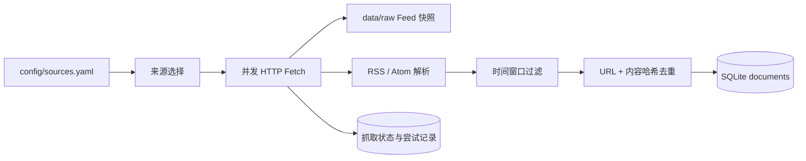

# 确定性信息采集

Task 3 提供不依赖模型的 RSS/Atom 采集层。它负责把公开来源转换成可追溯、可去重的本地
原文记录；事件归并、重要性判断和 24 小时/7 天分析属于后续阶段。

## 默认来源

来源注册表位于 `config/sources.yaml`，当前包含 17 个 Feed：

- Solana Status、Agave Releases、Jito-Solana Releases、Firedancer Releases；
- Jito Governance、Jupiter Research、Syndica Research；
- Ethereum Foundation Blog、go-ethereum Releases；
- Flashbots Collective、Uniswap Governance、Aave Governance；
- OpenAI Agents SDK Releases；
- Federal Reserve、European Central Bank、U.S. SEC；
- Global Disaster Alert and Coordination System。

每个来源明确标注主题和 Tier。治理论坛属于 Tier 3，只能触发进一步调查，不能单独支持
`confirmed`；Syndica 研究为 Tier 2，官方公告、软件发布和权威机构 Feed 为 Tier 1。新增来源时必须给出唯一 ID、
主页、Feed URL、Tier 和至少一个主题。

这只是可运行的首批来源，不代表最终覆盖已经完整。宏观数据日历、链上数据、论文、法院文件、
新闻媒体和需要认证的 API 将作为后续 adapter 加入。

## 采集流程



默认行为：

- 最多并发抓取 4 个来源；
- 单个来源超时 15 秒，最多读取 5 MiB；
- 只导入最近 8 天内容，每个 Feed 最多处理 50 条；
- 对网络错误、HTTP 429 和 5xx 进行一次短暂重试；
- 使用 ETag 与 Last-Modified 发起条件请求，304 不重复解析；
- 一个来源失败时其他来源继续，整轮状态记为 `partial`；
- 每个成功响应原样保存在 `data/raw/YYYY-MM-DD/<source-id>/`；
- HTML 只作为不可信内容转成纯文本，不执行脚本或 Feed 内指令。

Task 3 保存的是 Feed 提供的正文或摘要，并非所有网页的完整正文。后续若增加网页正文提取，必须
继续保留原始 URL、抓取时间和当前 Feed 快照。

## 使用命令

查看来源和最近状态：

```bash
pnpm sources
```

联网验证但不写数据库或原始文件：

```bash
pnpm collect:dry -- --source ethereum-foundation-blog
```

采集单个或多个来源：

```bash
pnpm collect -- --source ethereum-foundation-blog
pnpm collect -- --source federal-reserve-press --source ecb-press
```

采集全部启用来源：

```bash
pnpm collect
```

可使用 `--config`、`--path` 和 `--data-dir` 指定其他配置、数据库及原始数据目录。相对路径
统一相对于项目根目录解析。

命令退出码：

- `0`：所有来源成功或返回 304；
- `2`：部分或全部来源失败，但失败详情已经记录；
- `1`：配置无效、来源 ID 不存在或初始化错误。

## 持久状态

- `collection_runs`：整轮采集的来源数、成功/失败数、新增与重复文档数；
- `collection_attempts`：每个来源的 HTTP 状态、原始快照、条目数和错误；
- `source_fetch_state`：ETag、Last-Modified、最近成功时间和连续失败次数；
- `documents`：规范化标题、正文/摘要、发布时间、抓取时间、内容哈希和来源主题。

## Codex 网页发现

固定 RSS/Atom 采集之外，系统支持一次本地 Codex 网页发现：

1. `gpt-6-astra` low reasoning 读取 `config/discovery.yaml`；
2. 严格搜索晨报截止时间之前 24 小时的关注关键词；
3. 按 `prompts/discovery-daily.md` 生成可追溯 JSON；
4. 使用 `pnpm discovery:import -- --input <file>` 写入与 RSS 文档相同的候选管线。

网页发现项目必须包含直接原文 URL、发布时间、检索时间、topic 和来源等级；
搜索摘要、发布时间未知页面和窗口外内容不能导入。该任务不使用 OpenAI API Key，
但消耗用户的 Codex/ChatGPT 使用额度。

当前推荐调度为每天 06:00 执行网页发现、06:30 执行 RSS 采集与日报分析。

## Solana 重点来源与核对方式

`config/profile.yaml` 的 `editorial_focus` 由发现任务和研究编辑读取，用于同等质量事件间的
选题优先级，不是额外的数值评分项。MEV/DeFi 的 `include` 关键词参与现有候选分类和相关性
评分；Solana 保持生态维度，事件仍归入既有八个主题，不增加日报 Schema 字段。

`config/discovery.yaml` 增加 `solana-mev`、`solana-defi`、`solana-network` 三个独立搜索组。
每组执行开放检索与一手来源检索，另用 `reference_urls` 检查公告入口。以下来源补充 Feed
覆盖之外的信息：

| 来源                                                                                                                       | 用途                                  | 接入方式                                          |
| -------------------------------------------------------------------------------------------------------------------------- | ------------------------------------- | ------------------------------------------------- |
| [Jito Foundation](https://www.jito.network/blog/) / [Jito Labs 文档](https://docs.jito.wtf/lowlatencytxnsend/)             | MEV、BAM、bundle、订单流与机制变更    | 网页发现和核心事件补查                            |
| [Helius](https://www.helius.dev/blog) / [Anza](https://www.anza.xyz/blog) / [Solana News](https://solana.com/news)         | 执行、费用、客户端与共识研究          | 网页发现；研究结论须核对原始数据                  |
| [Kamino](https://kamino.com/blog) / [Drift](https://www.drift.trade/updates) / [Jupiter Research](https://discuss.jup.ag/) | 借贷、永续、清算、风险与治理          | 网页发现；论坛保持 Tier 3                         |
| [Jito tip API](https://bundles.jito.wtf/api/v1/bundles/tip_floor) / [Explorer](https://explorer.jito.wtf/)                 | 已落地 bundle 的 tip 分位数与交易记录 | 按需读取，保留响应时间；未接入定时 API 采集       |
| [DeFiLlama Solana](https://defillama.com/chain/solana)                                                                     | TVL、稳定币规模、DEX/永续成交量、费用 | 按需核对，标注统计窗口与口径；未接入定时 API 采集 |

2026-11-02 联网验证：新增 7 个 Feed 均返回 HTTP 200，且可解析为 RSS/Atom。
当次最近条目中，三个客户端 Feed 有近期版本；Solana Status、Jito/Jupiter 论坛与 Syndica
没有最近 8 天条目。Feed 可访问不等于当天有新信息，月报只在发布日期窗口内作为新报告，
所引用指标仍须标注其实际统计期间。

真实采集器的 dry-run 对 7 个新增 Feed 全部成功，识别出最近 8 天的 9 条客户端发布记录，
过滤 121 条窗口外内容。Jito tip API 和
[DeFiLlama 每日 TVL 历史 API](https://api.llama.fi/v2/historicalChainTvl/Solana)
也均返回 HTTP 200 和可解析 JSON；后者只提供每日 TVL，不包含其他网页指标。

没有将猜测的博客 Feed 加入采集器：Helius 路径返回非标准 Feed 内容，Kamino 跳转后是 HTML，
Drift 返回 404；Solana News 返回 429，Jito Blog 返回 403，保留为网页发现入口并如实报告访问缺口。
仪表盘/API 是核对来源，不可把检索时间当作新闻发布时间来导入 discovery，也不可将单次 tip
快照称为全天 MEV 收入，或将美元 TVL 变动直接称为资金净流入。
